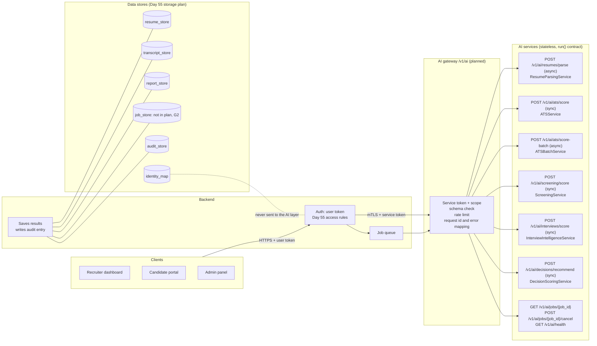
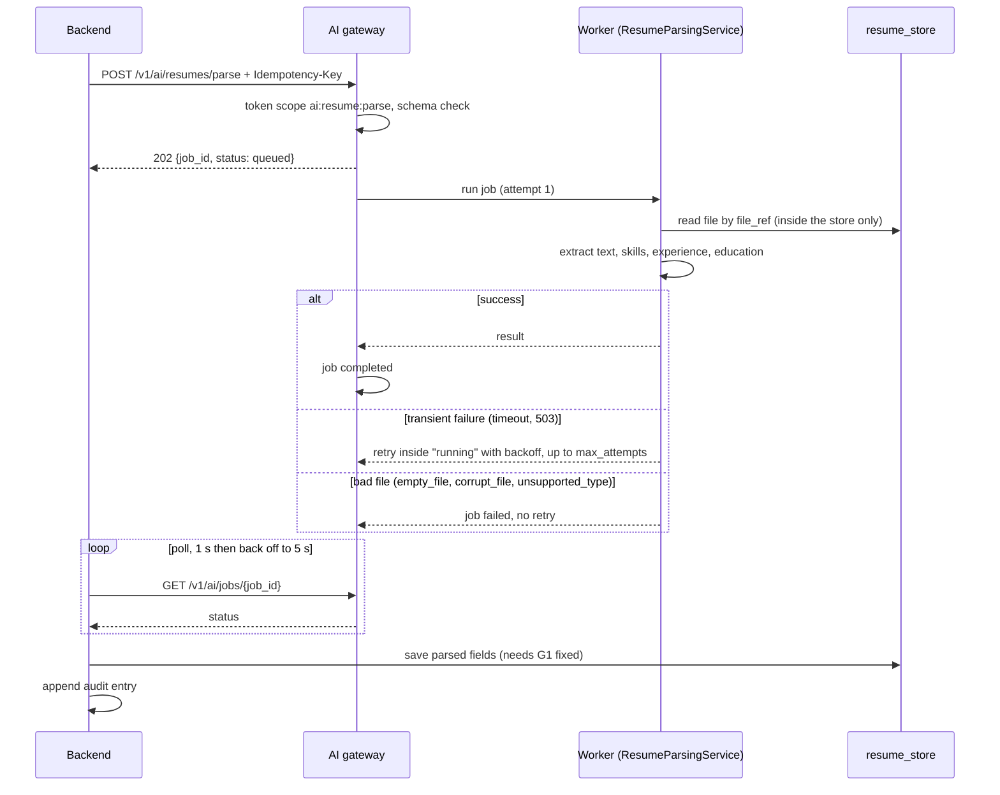
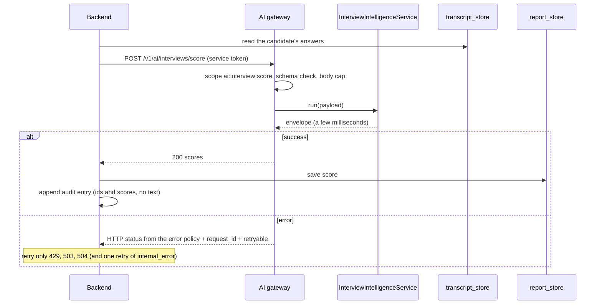
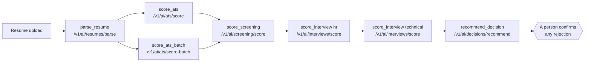
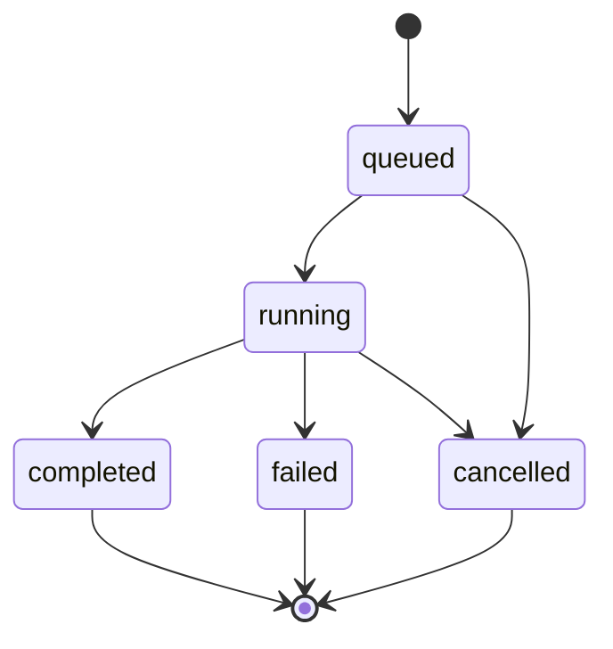

# Day 59 – API Mapping Diagram

Companion to `docs/day59_ai_integration_document.md`. The same picture is drawn four ways: who talks to whom, how an asynchronous resume job runs, how a real-time interview score runs, and where each AI API fits in the hiring pipeline. A rendered image of the first is at `data/integration/day59_api_mapping.png`.

The AI layer is stateless. The backend reads the input, calls the AI, saves the result and writes the audit entry.

## 1. Architecture: who calls what

## 2. Asynchronous: resume processing

## 3. Synchronous: real-time interview scoring

## 4. Where each API sits in the hiring pipeline

The machine-test round has its own engine but no service wiring yet (Day 57, open item O3), so it has no API in this plan.

## 5. Job states (Day 16, unchanged)

## 6. Operation to data map

Each row was checked against the Day 55 access rules for the service role.

| Operation | Reads | Writes | Check |
|---|---|---|---|
| `parse_resume` | resume_store | resume_store, audit_store | gap G1: the service cannot write a resume |
| `score_ats` | resume_store, job_store | report_store, audit_store | gap G2: no job store in the plan |
| `score_ats_batch` | resume_store, job_store | report_store, audit_store | gap G2 |
| `score_screening` | transcript_store | report_store, audit_store | allowed |
| `score_interview` | transcript_store | report_store, audit_store | allowed |
| `recommend_decision` | report_store | report_store, audit_store | allowed |

Not used by any AI operation: `recording_store` (no recordings exist yet) and `identity_map` (identity never goes to the AI layer).
