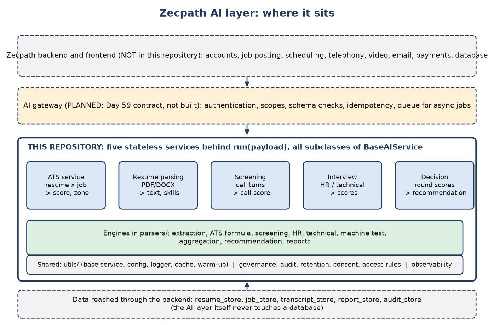
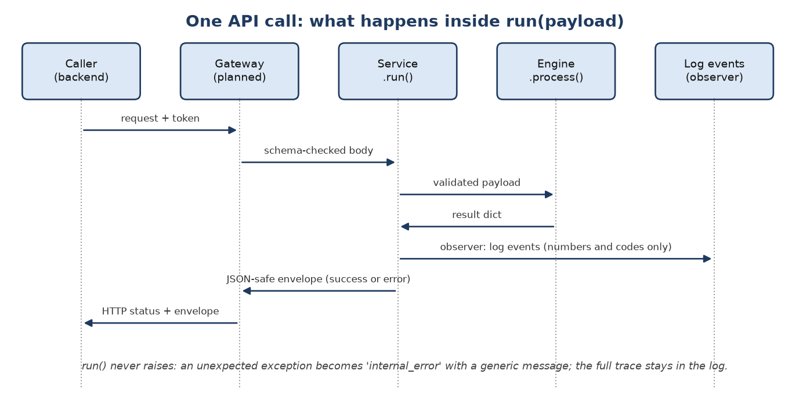
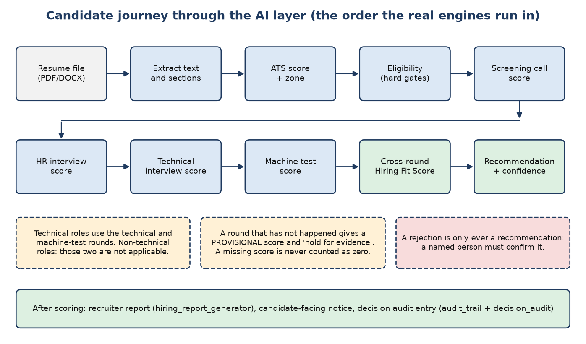
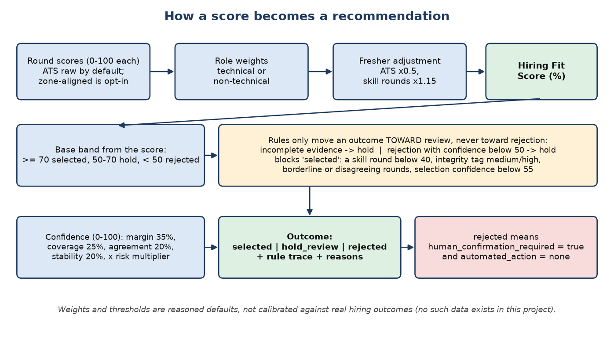

# Zecpath AI: System Architecture

Zecpath: AI Job Portal | System architecture documentation | Built 2026-11-20 (Day 62)

**Status words.** *Built* = code and tests exist. *Designed* = specified in code or a document, nothing enforces it yet. *Proposed* = a starting point to tune. *Not built* = absent. Numbers are read from the code when this document is generated.

## 1. Purpose and scope

The AI layer turns raw hiring inputs (a resume file, a job description, call turns, interview answers, execution results) into scores, explanations and a **recommendation for a person to act on**. It is the intelligence component of Zecpath. It is deliberately **not** the platform: accounts, scheduling, telephony, video, email, payments and the database belong to the backend.

**Goals the architecture serves:** explainable scores; no automated rejection; no personal content in logs; consistent contracts between services; scaling by adding replicas; the ability to change a model without changing an answer unnoticed.

**Constraints it accepts:** no trained models (no labelled outcome data exists), no real speech or video pipeline, no deployed infrastructure.

## 2. Context



| Neighbour | Direction | Contract |
|---|---|---|
| Zecpath backend | calls the AI layer; reads inputs; saves results and audit entries | Day 59 operations (`parse_resume`, `score_ats`, `score_ats_batch`, `score_screening`, `score_interview`, `recommend_decision`, `get_job`, `cancel_job`, `health`) |
| Speech-to-text provider | feeds call turns (text and a confidence) | `RawSTTResult` (a mock provider exists) |
| Voice / telephony provider | places calls | **not integrated**: the AI layer scores a conversation that has happened |
| Recruiters and candidates | see results through the backend | recommendation envelope, candidate-facing notice text |
| Auditors | read the audit log | hash-chained entries, replay |

## 3. Building blocks

| Block | Where | Responsibility |
|---|---|---|
| Service boundary | `utils/base_service.py` | `run()` validation, envelopes, error codes, JSON safety |
| ATS service and resume parsing | `ats_engine/` | resume x job score and zone; PDF/DOCX reading; batch scoring (process-parallel) |
| Screening service | `screening_ai/` | scores a call from turns |
| Interview service | `interview_ai/` | HR and technical answer scoring |
| Decision service | `scoring/` | Hiring Fit Score and recommendation |
| Engines | `parsers/` | all analysis logic (see the handbook's module reference) |
| Governance | `parsers/audit_trail.py`, `data_governance.py`, `access_control.py`, `secure_storage_plan.py`, `governance_framework.py`, `decision_audit.py` | audit, retention, consent, access, storage plan |
| Integration contract | `parsers/integration_contract.py`, `api/`, `schemas/` | operations, schemas, OpenAPI, error and retry rules |
| Observability | `parsers/observability.py`, `observability_plan.py` | structured logs, metrics, alert rules, dashboards |
| Performance | `utils/perf.py`, `utils/warmup.py`, `ats_engine/parallel.py` | bounded caches, warm-up, parallel batches |

Services are **independent**: no service imports another. Engines are shared libraries.

## 4. The request path



1. The caller sends a request with a scoped token (designed). The gateway checks the token and validates the body against the operation's JSON Schema, answering in the services' own error codes (designed).
2. `run(payload)` checks the payload is an object and calls `process`.
3. `process` reads fields with typed helpers (`_get_text`, `_get_list`, `_get_choice`, `_get_score`), which raise `ServiceInputError(code, message, field)`.
4. The engine computes the result; `to_json_safe` normalises it.
5. The service returns `success` or `error`. An unexpected exception becomes `internal_error`; the trace is logged, never returned.
6. An observer (prototype) records a log event of numbers and codes; the **backend** writes the audit entry. The AI layer never writes to a store.

## 5. Data flow across rounds



Data moves as small dictionaries of scores and codes between rounds. The raw inputs (resume text, answers, transcripts) are read by the service that scores them and are never copied into logs or audit entries. Stores named by the Day 59 plan: `resume_store`, `job_store`, `transcript_store`, `report_store`, `audit_store`.

| Operation | Reads | Writes |
|---|---|---|
| `parse_resume` | resume file | parsed fields, audit entry |
| `score_ats`, `score_ats_batch` | parsed resume, job description | score, audit entry |
| `score_screening` | transcript turns | score, audit entry |
| `score_interview` | candidate answers | score, audit entry |
| `recommend_decision` | round scores | decision, audit entry |

## 6. Scoring architecture



Each round has its own engine and 0 to 100 score; `cross_round_aggregation_engine` applies role weights (technical: ats 10 %, screening 10 %, hr_interview 20 %, technical_interview 30 %, machine_test 30 %; non-technical: ats 25 %, screening 15 %, hr_interview 60 %), the fresher adjustment and the missing-round rules; `final_recommendation_engine` applies the rule layer and confidence. Details and every weight are in the handbook, section 5.

## 7. Cross-cutting concerns

### 7.1 Errors
One envelope, a closed set of codes, `field` names the input at fault, `internal_error` hides internals. Gateway codes (`unauthenticated`, `forbidden`, `not_found`, `conflict`, `idempotency_conflict`, `rate_limited`, `service_unavailable`, `timeout`) are separate and carry retry advice.

### 7.2 Security (designed)
Scopes per operation, signed service tokens that carry tenant and pseudonymous actor, deny-by-default access control, paid-content unlock, TLS and encryption at rest through the storage plan. Known gaps G1 to G3 are listed in the handbook, section 10.

### 7.3 Privacy and fairness
Personal fields masked before scoring; demographic disclosures scrubbed from transcripts; verbal hesitation not used in decisions; logs and audit entries hold ids, scores and codes only.

### 7.4 Observability (designed, prototyped)
Three event kinds with a shared request id, a metrics registry with a label cap, 16 alert rules, five dashboards, a decision-audit recorder with replay.

### 7.5 Performance and scaling
Stateless workers; one process per core; warm-up before readiness; bounded content-keyed caches; process-parallel batches (`ZECPATH_BATCH_WORKERS`). Measured: scoring is cheap (about 22 ms of compute per application), so scale is about shape (redundancy, isolating slow from quick work, absorbing bursts), not raw size.

## 8. Deployment view (proposed)

| Tier | Contents | Balancing | Scaling signal |
|---|---|---|---|
| Sync | ATS, screening, interview, decision workers | layer-7, least outstanding requests | utilisation and p95 latency |
| Async | resume parsing and batch scoring workers | one shared queue, competing consumers | queue age |
| Gateway | authentication, schema checks, idempotency | n/a | request rate |
| State | job store and idempotency store (the only shared state) | n/a | n/a |

A worker is ready only after warm-up. Memory per worker: about 154 MB if it scores resumes, 41 MB if it parses files, 19 MB otherwise (measured, Day 60).

**Container recipe (not built, not run):**

```dockerfile
FROM python:3.11-slim
WORKDIR /app
COPY requirements.txt .
RUN pip install --no-cache-dir -r requirements.txt
COPY ats_engine screening_ai interview_ai scoring parsers utils schemas api ./
ENV ZECPATH_ENV=production
# a worker entry point (an HTTP server around run(payload)) does not exist yet; it is part of the gateway work
```

## 9. Key design decisions

| # | Decision | Why | Day |
|---|---|---|---|
| 1 | One `run()` boundary that never raises | callers must never see internals or crash | 57 |
| 2 | Stateless AI layer | safe retries, one writer of the audit log, easy scaling | 59 |
| 3 | Rule-based scoring with visible components | no training data; explainability | 13, 26, 37, 47 |
| 4 | Missing evidence is never zero | silently punishing a candidate for a round that has not happened is unfair | 13, 51, 57 |
| 5 | Rejection is a recommendation | the costly, hard-to-reverse error is a wrongful rejection | 41, 52 |
| 6 | No camera or audio analysis | biometric data without consent infrastructure or fairness review | 48, 49 |
| 7 | Never run candidate code | needs a real sandbox; `exec()` is not one | 50 |
| 8 | Allowlisted logging | logs are an uncontrolled copy of data | 61 |
| 9 | Processes, not threads, for parallelism | pure-Python CPU work; measured | 60 |
| 10 | Golden files for optimisation | prove answers did not change | 60 |

## 10. Risks and open decisions

Choose the gateway, queue, identity provider, log shipper, metrics store, alert manager and dashboard tool; build the job store; resolve gaps G1 to G3; obtain labelled outcomes to calibrate weights; add a real STT and voice provider; commission a legal review and a bias audit before real use. Each is traced to the day that raised it in the handbook (section 11).
