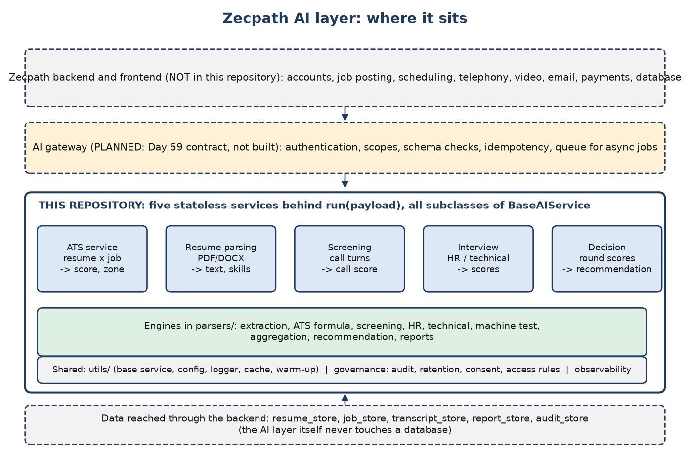
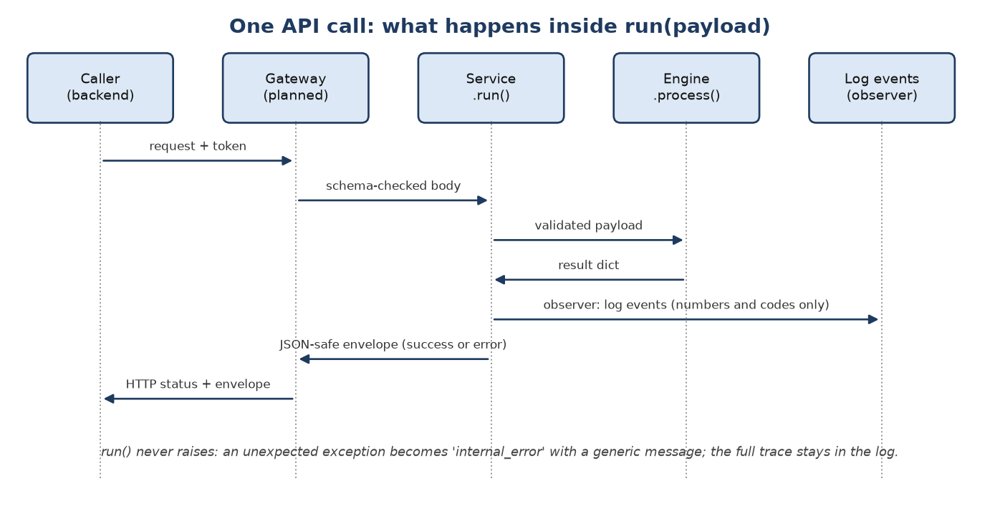
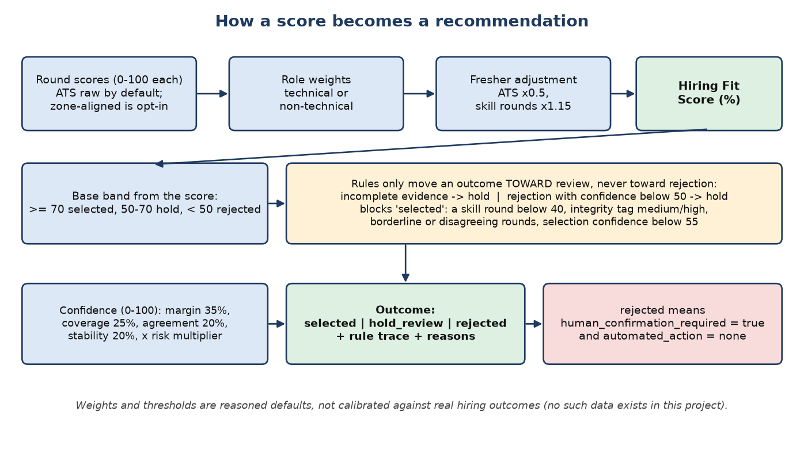
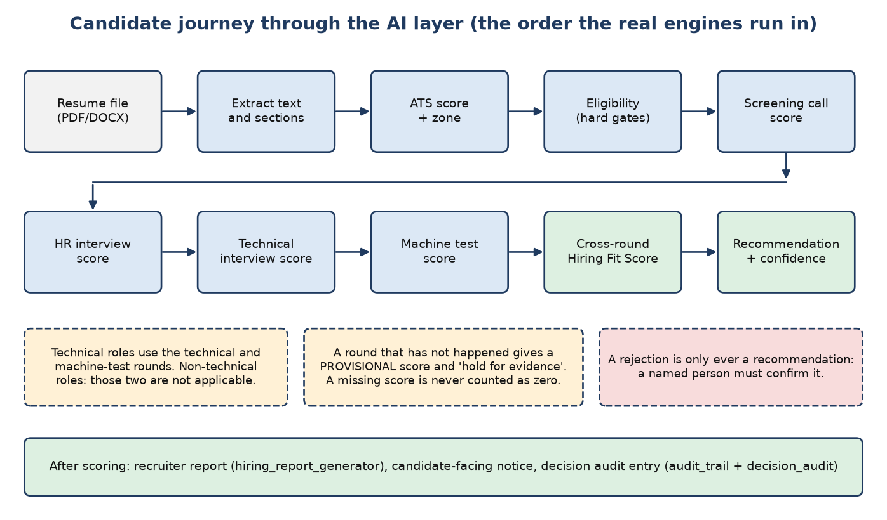

# Zecpath AI Technical Handbook

Zecpath: AI Job Portal | Technical handbook for the AI system | Built 2026-11-20 (Day 62)

## How to read this handbook

**Who it is for.** Developers who will build, change or run the Zecpath AI layer; reviewers who need to know what exists; and the next person who inherits the project.

**What it covers.** The AI layer in this repository: 76 Python files (64 in `parsers/`, 7 service files and 5 shared utilities), its schemas, tests and documents. It does **not** cover the Zecpath backend, frontend, telephony, video, email or payments: they are not in this repository (section 1.3 says exactly where the line is).

**Three words are used with care.**

| Word | Meaning here |
|---|---|
| **Built** | The code exists, has tests, and was run on real inputs in this project. |
| **Designed** | The logic or plan exists as code or a document, but nothing enforces it yet (no database, gateway, queue, login or dashboard exists). |
| **Not built** | Nothing in this repository does it. |

**Where the numbers come from.** Every weight, threshold, retention period, API operation and error rule in this handbook is read from the code when the handbook is built (`parsers/documentation_index.py`), and every example request and response is real service output. A test fails when this document and the code disagree. Prose is written by hand and is the author's judgement.

**Contents.** 1 System overview. 2 Architecture. 3 Module reference. 4 APIs. 5 Scoring logic. 6 Data models. 7 Workflows. 8 Setup and deployment. 9 Quality, performance and operations. 10 Governance and security. 11 Known limits and open items. 12 Where to go next. Appendices: glossary, document index.

The system architecture document (`docs/day62_system_architecture.md`) and the developer onboarding guide (`docs/day62_developer_onboarding_guide.md`) are the two companion deliverables; this handbook contains the same facts in one place.

---

## 1. System overview

### 1.1 What the AI layer is

Zecpath is an AI-powered hiring platform. A candidate moves through rounds (resume screening, voice screening, HR interview, technical interview, machine test, final round), and each round produces evidence about the candidate. **The AI layer is the part that turns raw inputs (a resume file, a job description, call turns, interview answers) into scores, explanations and a recommendation a recruiter can act on.** It is a set of small, stateless services written in Python.

It does five things:

1. **Reads resumes and job descriptions** and scores the fit (the ATS).
2. **Scores a screening call** from its transcript turns.
3. **Scores an HR interview and a technical interview** from the candidate's answers; evaluates machine-test attempts.
4. **Combines the rounds** into one Hiring Fit Score and a recommendation: selected, hold for review, or rejected.
5. **Explains and records** every decision, with governance rules (access, consent, retention, audit) and observability designed around it.

### 1.2 Design principles

These ten rules shape every module. They were reached by finding real problems (the Day number is where each was decided) and a new module is expected to follow them.

| # | Principle | What it means in practice |
|---|---|---|
| 1 | **The boundary never throws** (Day 57) | Call `run(payload)`, not `process()`. It always returns a success or an error envelope, and never leaks a stack trace. |
| 2 | **Stateless** (Day 59) | A service reads its payload and returns a result. It never connects to a database; the backend saves results and writes the audit entry. |
| 3 | **Explainable** (Days 13, 51, 52) | A score carries its components, weights and contributions; a decision carries its rule trace and reasons. |
| 4 | **Missing is not zero** (Days 13, 51, 57) | A missing section redistributes weight; a round that has not happened makes the result *provisional*, never a zero. |
| 5 | **A rejection is only a recommendation** (Days 41, 52) | The policy object refuses to be configured to reject automatically; a named person must confirm every rejection. |
| 6 | **No personal content in logs or audit entries** (Days 55, 61) | Fields are allowlisted; text, names, emails and transcripts are refused. |
| 7 | **Reduce bias before scoring** (Days 15, 43) | Personal fields are masked before a resume is scored; volunteered demographic disclosures are scrubbed from transcripts. |
| 8 | **Never claim a capability that does not exist** (Days 48, 49, 50) | Gaze tracking, external-voice detection and running candidate code were deliberately not faked; every report lists what it cannot see. |
| 9 | **Rules and reasoned weights, not trained models** | The scoring is rule-based and deterministic. Weights and thresholds are reasoned, not calibrated: no labelled hiring-outcome data exists in this project. |
| 10 | **Change without changing answers** (Day 60) | Optimisations are checked against golden files generated from the code before the change. |

### 1.3 What the PRD asks for and what this repository holds

The PRD (Parts 1 to 6) describes 100 phases. This repository is the AI layer only, so many phases are, rightly, elsewhere. This table is the honest map.

| PRD phase | Status | What this repository holds | What is not here |
|---|---|---|---|
| 1  Job portal foundation | Partly | Resume file reading (PDF, DOCX) and job-description parsing. | Company registration, dashboards, job posting UI, candidate accounts, DOC files: backend and frontend work. |
| 2  AI ATS | Built | Parsing, four-component scoring, ranking, zones, fairness masking, batch scoring. | A trained model: scoring is rule-based and TF-IDF, with reasoned (not calibrated) weights. |
| 3  Eligibility and call trigger | Partly | Eligibility engine: hard gates, then zone. | Call windows, retries, scheduling: backend work. |
| 4  AI voice calling | Not built | Nothing places a call. Speech-to-text is a mock provider behind an interface. | Telephony (for example Twilio), text-to-speech, voice and language selection. |
| 5  Screening conversation | Built | Question bank, flow state machine, answer understanding, scoring, report. | Generated speech and real audio; answers arrive as text turns. |
| 6-8  Scheduling, reminders, notifications | Not here | - | Backend, calendar and messaging integration. |
| 9  Recruiter dashboard and analytics | Designed | Hiring report generator; observability dashboard definitions. | Any user interface. |
| 10  Admin, security, compliance | Designed | Audit log, retention, consent, access rules, storage plan: logic and tests. | Enforcement infrastructure: database, key service, login, intake screens. |
| 11-13  Video infrastructure, camera checks, instructions | Not built | - | Browser and WebRTC client work. |
| 14  Voice personality and cloning | Not built | - | Voice provider; consent infrastructure. |
| 15-17  HR questions, communication, aptitude | Built | Question bank, follow-ups, text-based communication scoring, aptitude engine. | Audio features (pace, tone) need an audio pipeline. |
| 18  Facial expression and behaviour | Replaced | Non-invasive timing and text signals (Day 48). | Gaze, head movement and facial analysis were deliberately not built (biometric, no consent infrastructure). |
| 19  Malpractice and integrity | Partly | Tab-switch and focus-loss events. | External voice, looking away and phone use are listed as not implemented in every report. |
| 20-21  Scoring, decision, selection mail | Partly | Scoring and decision engines; candidate-facing notice text. | Sending mail. |
| 22  Recording and secure storage | Designed | Storage plan with checked invariants. | The storage itself. |
| 23-24  Paid access, recruiter review | Partly | Paid-content unlock rule in access control; summary and report generators. | Payments and the review UI. |
| 25  Compliance and consent | Designed | Consent registry, retention rules, audit trail. | Legal review; real consent capture. |
| 26-50  Second round and technical interview | Partly | Technical question bank, scoring, aggregation, final recommendation, report. | Calls, emails, video, interviewer voice. |
| 51-75  Machine test | Partly | Evaluation of execution results and static code analysis. | A sandboxed runner, live editor and screen recording. |
| 76-90  Final round and salary negotiation | Not built | - | Negotiation engine, market benchmarks, final interview. |
| 91-100  Offer and onboarding | Not built | - | Offer letters, acceptance tracking. |

### 1.4 The numbers at a glance

| Measure | Value |
|---|---|
| Python files in the AI layer | 76 |
| Engines in `parsers/` | 64 |
| Services (stable API boundary) | 7 |
| Test files / test functions | 68 / 1,622 |
| API version | 1.0 |
| Documents in `docs/` | 65 |

The last full regression recorded in the repository (Day 61) reports 2,017 passed and 6 skipped; a parametrised test counts once per case, which is why that is more than the number of test functions.

---

## 2. Architecture



### 2.1 The three levels

1. **Backend and frontend (not in this repository).** Accounts, job posting, scheduling, telephony, video, email, payments and the database. The backend authenticates users, reads inputs from its stores, calls the AI layer, saves the results and appends the audit entry.
2. **AI gateway (designed in Day 59, not built).** Authentication with scoped service tokens, request-schema checks, idempotency keys, a queue for asynchronous jobs.
3. **The AI layer (this repository).** Seven service classes behind one contract, built on the engines in `parsers/`.

### 2.2 One request



Every service subclasses `BaseAIService` (`utils/base_service.py`) and implements `process(payload)`. Callers use `run(payload)`, which:

- checks the payload is a JSON object, calls `process`, and makes the result JSON-safe (NaN and infinity become `null`, enums become values, dataclasses become dictionaries);
- turns a bad input into an error envelope with a machine-readable `code` and the `field` at fault;
- turns an unexpected exception into `internal_error` with a generic message, and logs the full trace;
- refuses text over 200,000 characters and lists over 200 items rather than truncating silently.

### 2.3 Layers of the code

| Layer | What it holds | Modules |
|---|---|---|
| A | Foundation (shared code every service uses) | 5 |
| B | Resume and job-description understanding | 14 |
| C | ATS scoring, ranking and eligibility | 5 |
| D | Voice screening call | 10 |
| E | HR interview | 11 |
| F | Technical interview, machine test, behaviour and integrity | 5 |
| G | Aggregation, final recommendation and reporting | 3 |
| H | Governance, audit and security | 6 |
| I | Integration, operations and quality tooling | 10 |
| S | Services (the stable API boundary) | 7 |

**Rule: services do not import one another.** Communication between services goes through the gateway (REST, queue or webhook). Inside `tests/` direct imports are fine. The engines in `parsers/` are shared libraries and may import each other.

### 2.4 Folder structure

```
zecpath-ai/
  ats_engine/      resume parsing, ATS scoring, batch scoring            (services)
  screening_ai/    screening-call scoring                                (service)
  interview_ai/    HR and technical interview scoring                    (service)
  scoring/         decision and recommendation                           (service)
  parsers/         all engines, governance, integration and ops modules
  utils/           base service, config, logger, cache, warm-up
  api/             OpenAPI files (ATS, screening, HR interview, integration)
  schemas/         JSON Schemas and the transcript SQL schema
  tests/           pytest suite, one file per module; tests/golden/ holds golden outputs
  docs/            one document per day's work; docs/diagrams/ holds the pictures
  data/            sample resumes and job descriptions, reports, results (real data is gitignored)
  logs/            run logs (gitignored except .gitkeep)
  run_dayNN_*.py   one demo script per day
```

---

## 3. Module reference

Every module starts with a docstring that states what it does, its input contract and its output contract; the docstring is the source of truth and this table is the map. Lines are counted from the files. **PRD phase** names the phases (section 1.3) the module serves; "-" means it serves the platform rather than one phase.

### 3.1 How the layers cooperate

- **B (understanding)** turns files and text into structured resume and job data: `resume_extractor` reads the file, `section_classifier` and `section_extractor` find the sections, `skill_extractor`, `experience_parser` and `education_parser` read each, `jd_parser` does the same for a job description, `semantic_matcher` compares the two texts, and `fairness_engine` masks personal fields first.
- **C (ATS)** combines the four component scores in `ats_scoring_engine.score_candidate()`, assigns a zone with `ranking_engine.classify_zone()`, and decides who may receive a call with `eligibility_engine.evaluate_eligibility()`.
- **D (screening)** runs a call as a state machine (`conversation_flow_engine`), understands each answer (`answer_intent_engine`), scores the call (`screening_scoring_engine`) and writes the report; `screening_pipeline.run_screening_call()` runs the whole chain.
- **E (HR interview)** asks questions (`hr_interview_question_bank`), decides follow-ups, scores communication, confidence, relevance and consistency and combines them in `hr_interview_scoring_engine.score_hr_interview()`; `aptitude_logic_engine` adds logic and situational questions.
- **F (technical)** has its own question bank and scoring (`technical_skill_scoring_engine.build_technical_evaluation_report()`); `machine_test_evaluation_engine.build_machine_test_report()` scores code attempts without running them; `behavioral_signal_engine` and `integrity_detection_engine` supply timing and tab-focus signals.
- **G (decision)** combines every round in `cross_round_aggregation_engine.compute_cross_round_score()`, turns it into an outcome with `final_recommendation_engine.decide()`, and `hiring_report_generator.generate_hiring_report()` assembles the recruiter report.
- **H (governance)** wraps the above: audit log, retention, consent, access control, a storage plan, and `governance_framework.GovernanceService` applies them in one call.
- **I (operations)** holds the API contract, observability, the capacity model and the quality tools.

### Services (the stable API boundary)

| Module | Lines | What it does | PRD phase |
|---|---|---|---|
| `ats_engine/batch_service.py` | 87 | ATSBatchService: one job description, many resumes, one independent result per candidate. | 2 |
| `ats_engine/parallel.py` | 79 | Process-based parallel batch scoring (threads cannot speed up pure-Python CPU work). | 2 |
| `ats_engine/resume_parsing_service.py` | 168 | ResumeParsingService: reads a PDF/DOCX and returns text, skills, experience, education; no name, email or phone. | 1, 2 |
| `ats_engine/service.py` | 101 | ATSService: scores one resume against one job description; returns score, zone and components. | 2 |
| `interview_ai/service.py` | 97 | InterviewIntelligenceService: scores HR and technical interview answers. | 15, 16, 37-40 |
| `scoring/service.py` | 110 | DecisionScoringService: combines round scores into a hiring-fit score and a recommendation. | 20, 45, 70, 71 |
| `screening_ai/service.py` | 64 | ScreeningService: scores a screening-call conversation that has already happened. | 5 |

### Foundation (shared code every service uses)

| Module | Lines | What it does | PRD phase |
|---|---|---|---|
| `utils/base_service.py` | 176 | BaseAIService: the run() boundary that never raises, the response envelope and the error codes. | - |
| `utils/config.py` | 23 | Environment-driven settings (ZECPATH_ENV, service name, model version, placeholders for storage and queue). | - |
| `utils/logger.py` | 56 | get_logger(): console plus rotating file log in logs/zecpath_ai.log. | - |
| `utils/perf.py` | 142 | BoundedLRU cache and the switch (ZECPATH_CACHE) used by every Day 60 optimisation. | - |
| `utils/warmup.py` | 93 | Loads the heavy parts once at start so the first request is not slow. | - |

### Resume and job-description understanding

| Module | Lines | What it does | PRD phase |
|---|---|---|---|
| `parsers/education_dictionary.py` | 39 | Degree and certification vocabularies. | 2 |
| `parsers/education_parser.py` | 135 | Parses degrees and certifications from the education section. | 2 |
| `parsers/education_relevance.py` | 93 | Scores how well the education fits the target level. | 2 |
| `parsers/experience_parser.py` | 220 | Parses the experience section into dated entries and total years. | 2 |
| `parsers/experience_relevance.py` | 109 | Scores how relevant the work history is to the target job title. | 2 |
| `parsers/fairness_engine.py` | 336 | Normalises resume text, masks personal fields, damps keyword stuffing, reports bias indicators. | 2 |
| `parsers/jd_parser.py` | 208 | Turns a raw job description into required skills, experience and responsibilities. | 1, 2 |
| `parsers/resume_extractor.py` | 224 | Reads a PDF or DOCX file, returns clean text; refuses empty, corrupt or unsupported files. | 1, 2 |
| `parsers/resume_parser.py` | 34 | Thin shared entry point to the resume extraction helpers. | 2 |
| `parsers/section_classifier.py` | 205 | Tags each resume line with its section (skills, experience, education ...). | 2 |
| `parsers/section_extractor.py` | 90 | Pulls the skills / experience / responsibilities blocks out of resume and JD text. | 2 |
| `parsers/semantic_matcher.py` | 179 | TF-IDF cosine similarity between resume and job description (not a neural model). | 2 |
| `parsers/skill_dictionary.py` | 96 | Master skill list grouped by domain (tech, business, creative) with aliases. | 2 |
| `parsers/skill_extractor.py` | 231 | Finds skills in resume or JD text using the dictionary. | 2 |

### ATS scoring, ranking and eligibility

| Module | Lines | What it does | PRD phase |
|---|---|---|---|
| `parsers/ats_scoring_engine.py` | 276 | The ATS formula: four weighted components, weight redistribution when a section is missing. | 2 |
| `parsers/eligibility_engine.py` | 301 | Hard gates first (mandatory skills, experience floor), then the zone: who may receive a screening call. | 3 |
| `parsers/ranking_engine.py` | 241 | Ranks candidates and assigns the shortlist / review / reject zone with per-category cutoffs. | 2, 3 |
| `parsers/resume_readiness.py` | 151 | Prototype: tells a candidate whether the system can read their resume. | - |
| `parsers/scoring_calibration.py` | 99 | Opt-in alignment of the ATS score to the common scale (the aggregate still defaults to the raw score). | 70 |

### Voice screening call

| Module | Lines | What it does | PRD phase |
|---|---|---|---|
| `parsers/answer_intent_engine.py` | 495 | Understands an answer: which category it addresses, quality, extracted value (rule-based). | 5 |
| `parsers/confidence_sentiment_engine.py` | 367 | Text signals: hesitation, sentiment and confidence cues. | 5, 16 |
| `parsers/conversation_flow_engine.py` | 321 | State machine for the call: ask, re-ask, clarify, end; fixed message templates. | 5 |
| `parsers/edge_case_handler.py` | 255 | Poor audio, language mismatch and crash safety for the call flow. | 5 |
| `parsers/screening_pipeline.py` | 141 | Runs the whole screening chain start to finish: run_screening_call(). | 5 |
| `parsers/screening_question_bank.py` | 302 | The screening questions (introduction, education, experience, skills, location, notice period, salary). | 5 |
| `parsers/screening_report_generator.py` | 273 | Turns a scored call into a recruiter-readable screening report. | 5 |
| `parsers/screening_scoring_engine.py` | 323 | Scores a call on clarity, relevance, completeness and consistency. | 5 |
| `parsers/speech_to_text.py` | 249 | Speech-to-text provider interface and transcript cleaning (a mock provider; no real STT yet). | 5 |
| `parsers/transcript_schema.py` | 329 | Data model of a call: CallSession, TranscriptTurn, NormalizedAnswer; matches schemas/transcript_schema.sql. | 5 |

### HR interview

| Module | Lines | What it does | PRD phase |
|---|---|---|---|
| `parsers/aptitude_logic_engine.py` | 352 | Logic puzzles and situational-judgement questions with scoring. | 17 |
| `parsers/communication_skill_engine.py` | 435 | Per-answer communication score: fluency, grammar, vocabulary, structure (text only). | 16 |
| `parsers/confidence_stress_engine.py` | 315 | Per-answer confidence and stress indicators from text. | 16, 18 |
| `parsers/hr_followup_engine.py` | 333 | Decides when a follow-up is needed and what kind. | 15 |
| `parsers/hr_interview_finalization.py` | 79 | HR interview wrap-up: demo and readiness checks. | - |
| `parsers/hr_interview_question_bank.py` | 319 | HR question bank by role type and experience level; InterviewSession state. | 15 |
| `parsers/hr_interview_scoring_engine.py` | 339 | HR score: relevance 35%, communication 25%, confidence 25%, consistency 15%. | 16, 20 |
| `parsers/hr_interview_simulation.py` | 159 | Scripted HR interviews to validate the whole HR chain. | - |
| `parsers/interview_summary_generator.py` | 301 | Strengths, weaknesses, culture-fit indicators, risk flags and a narrative. | 24 |
| `parsers/transcript_demographic_scrubber.py` | 125 | Removes volunteered demographic disclosures from answers before storage or scoring. | 25 |
| `parsers/unified_scoring_engine.py` | 222 | Day 41 three-round score (ATS, screening, HR); kept; the five-round engine extends it. | 20 |

### Technical interview, machine test, behaviour and integrity

| Module | Lines | What it does | PRD phase |
|---|---|---|---|
| `parsers/behavioral_signal_engine.py` | 276 | Non-invasive behaviour signals from timing and text; no camera analysis. | 18, 41 |
| `parsers/integrity_detection_engine.py` | 621 | Integrity tag from tab-switch and focus-loss events; unobservable signals are listed as not implemented. | 19, 42 |
| `parsers/machine_test_evaluation_engine.py` | 843 | Scores machine-test attempts from execution results and static code analysis; never runs candidate code. | 62-69 |
| `parsers/technical_interview_question_bank.py` | 309 | Technical questions by domain and experience tier; TechnicalInterviewSession. | 37, 38 |
| `parsers/technical_skill_scoring_engine.py` | 468 | Technical score: accuracy 40%, depth 20%, reasoning 20%, real-world 20%. | 40, 44 |

### Aggregation, final recommendation and reporting

| Module | Lines | What it does | PRD phase |
|---|---|---|---|
| `parsers/cross_round_aggregation_engine.py` | 622 | Five-round Hiring Fit Score with role weights, fresher adjustment, sensitivity and flags. | 70 |
| `parsers/final_recommendation_engine.py` | 575 | Selected / hold_review / rejected with confidence and rule trace; a rejection is never automatic. | 45, 71 |
| `parsers/hiring_report_generator.py` | 822 | One recruiter-facing report from all round results. | 24, 47, 49 |

### Governance, audit and security

| Module | Lines | What it does | PRD phase |
|---|---|---|---|
| `parsers/access_control.py` | 176 | Role matrix and contextual rules, deny by default; paid-content unlock flag. | 23, 25, 48 |
| `parsers/audit_trail.py` | 332 | Append-only hash-chained audit log; refuses personal content and automated rejections. | 25, 50 |
| `parsers/data_governance.py` | 283 | Retention rules per data category and the consent registry (default deny). | 25, 50 |
| `parsers/decision_audit.py` | 142 | Decision-audit recorder: inputs entry, result entry, replay and completeness check. | 25, 50 |
| `parsers/governance_framework.py` | 113 | One call that applies access, consent, retention and audit in order. | 25, 50 |
| `parsers/secure_storage_plan.py` | 171 | Six-store storage plan and 12 invariants it is checked against. | 22, 43 |

### Integration, operations and quality tooling

| Module | Lines | What it does | PRD phase |
|---|---|---|---|
| `parsers/consistency_audit.py` | 275 | Property checks that the aggregate, decision and ATS alignment must satisfy. | - |
| `parsers/documentation_index.py` | 248 | Module catalogue, PRD coverage map and live numbers the handbook is generated from. | - |
| `parsers/evaluation_harness.py` | 268 | The one tested confusion-matrix and threshold-analysis tool. | - |
| `parsers/integration_contract.py` | 772 | API catalogue, JSON Schemas, OpenAPI, error rules, retry and idempotency logic. | - |
| `parsers/observability.py` | 469 | Structured logger with allowlist and privacy guard, metrics registry, service observer. | 9, 10 |
| `parsers/observability_plan.py` | 660 | Metric catalogue, SLOs, alert rules and engine, dashboard definitions. | 9, 10 |
| `parsers/pipeline_simulation.py` | 535 | Runs a candidate through the real engines from file to report. | - |
| `parsers/roadmap_planner.py` | 219 | Keeps the Day 58 roadmap data consistent and ordered. | - |
| `parsers/scaling_model.py` | 167 | Queueing and capacity model used by the scalability strategy. | - |
| `parsers/stability_checks.py` | 436 | Edge-case sweep and output sanity checks over every public engine. | - |

---

## 4. APIs

### 4.1 The operations

All paths start with `/v1/ai`. **Sync** operations answer at once (HTTP 200); **async** operations return 202 and a job to poll. "Implemented by" names the class that exists today; the HTTP gateway around every row is **planned**, not built.

| Operation | Method and path | Mode | Scope | Timeout (proposed) | Implemented by (class) |
|---|---|---|---|---|---|
| `parse_resume` | POST `/v1/ai/resumes/parse` | async | `ai:resume:parse` | 60 s | ResumeParsingService |
| `score_ats` | POST `/v1/ai/ats/score` | sync | `ai:ats:score` | 2 s | ATSService |
| `score_ats_batch` | POST `/v1/ai/ats/score-batch` | async | `ai:ats:score` | 120 s | ATSBatchService |
| `score_screening` | POST `/v1/ai/screening/score` | sync | `ai:screening:score` | 2 s | ScreeningService |
| `score_interview` | POST `/v1/ai/interviews/score` | sync | `ai:interview:score` | 2 s | InterviewIntelligenceService |
| `recommend_decision` | POST `/v1/ai/decisions/recommend` | sync | `ai:decision:recommend` | 2 s | DecisionScoringService |
| `get_job` | GET `/v1/ai/jobs/{job_id}` | sync | `ai:jobs:read` | 2 s | (gateway, planned) |
| `cancel_job` | POST `/v1/ai/jobs/{job_id}/cancel` | sync | `ai:jobs:cancel` | 2 s | (gateway, planned) |
| `health` | GET `/v1/ai/health` | sync | none | 1 s | (gateway, planned) |

Machine-readable contracts: `schemas/integration_api_schemas.json` (JSON Schema 2020-12) and `api/integration_openapi.yaml` (OpenAPI 3.1) are **generated** from `parsers/integration_contract.py`, and a test fails if the files in the repository differ from what the code generates. Older session-style contracts remain: `api/openapi.yaml` (ATS), `api/screening_openapi.yaml`, `api/hr_interview_openapi.yaml`.

### 4.2 The response envelope

Every response, from every service, is one of two shapes.

**Success** (real output of `ATSService().run(...)`):

```json
{
  "resume_text": "Asha Nair\nSkills\nReact, Node.js, MongoDB, Express, JavaScript, Git\nExperience\nSoftware ...",
  "job_description": "MERN Stack Developer\nRequirements\nReact, Node.js, MongoDB, Express\n3+ years experience\n..."
}
```

```json
{
  "service": "ats_ai_service",
  "model_version": "v0.1.0",
  "api_version": "1.0",
  "status": "success",
  "scoring_mode": "ats_engine",
  "ats_score": 66.4,
  "zone": "shortlist",
  "role_category": "tech",
  "components": [
    {
      "name": "skill_match",
      "score": 100.0,
      "available": true
    },
    {
      "name": "experience",
      "score": 52.9,
      "available": true
    },
    {
      "name": "education",
      "score": 0.0,
      "available": false
    },
    {
      "name": "semantic",
      "score": 27.8,
      "available": true
    }
  ],
  "warnings": []
}
```

**Error** (a bad request, real output):

```json
{
  "service": "ats_ai_service",
  "model_version": "v0.1.0",
  "api_version": "1.0",
  "status": "error",
  "error": {
    "code": "invalid_input",
    "message": "'resume_text' must be text, got int.",
    "field": "resume_text"
  }
}
```

`status` is `success` or `error`. On error, `error.code` is machine-readable and `error.field` names the input at fault (or `null`).

### 4.3 More real examples

**Screening call.** Seven turns; `notice_period` comes back in `categories_missing`, so the call is `incomplete` and the score covers the answered categories only:

```json
{
  "candidate_id": "C001",
  "job_role": "MERN Stack Developer",
  "turns": [
    {
      "text": "Hi, I am Asha, a software engineer with three years of experience in web development."
    },
    {
      "text": "I did my B.Tech in computer science in 2021."
    },
    "... 5 more"
  ]
}
```

```json
{
  "service": "screening_ai_service",
  "model_version": "v0.1.0",
  "api_version": "1.0",
  "status": "success",
  "candidate_id": "C001",
  "call_status": "incomplete",
  "screening_score": 76.4,
  "categories_answered": [
    "introduction",
    "education",
    "experience",
    "skills",
    "location",
    "salary"
  ],
  "categories_missing": [
    "notice_period"
  ],
  "turns_used": 7,
  "warnings": [
    "The call is incomplete: the score covers only the answered categories."
  ]
}
```

**HR interview** (`interview_type: hr`):

```json
{
  "service": "interview_intelligence_service",
  "model_version": "v0.1.0",
  "api_version": "1.0",
  "status": "success",
  "interview_type": "hr",
  "interview_status": "scored",
  "hr_score": 76.2,
  "communication_score": 75.0,
  "technical_score": null,
  "relevance_score": 60.0,
  "confidence_score": 100.0,
  "answers_scored": 2,
  "answers_ignored": 0,
  "non_substantive_answers": 0,
  "warnings": []
}
```

**Decision** (the recommendation; read the flags):

```json
{
  "service": "decision_scoring_service",
  "model_version": "v0.1.0",
  "api_version": "1.0",
  "status": "success",
  "candidate_id": "C001",
  "hiring_fit_score": 76.5,
  "decision": "selected",
  "hold_kind": null,
  "confidence": 66.4,
  "provisional": false,
  "missing_rounds": [],
  "human_review_required": false,
  "human_review_reasons": [],
  "human_confirmation_required": false,
  "automation_eligible": false,
  "automated_action": "none",
  "reasons": [
    "Hiring Fit 76.5% clears the selection threshold (70) with no rule blocking it."
  ],
  "warnings": []
}
```

### 4.4 Errors and retries

| Error code | HTTP | Raised by | Max retries |
|---|---|---|---|
| `invalid_payload` | 400 | service | 0 |
| `invalid_input` | 422 | service | 0 |
| `missing_field` | 422 | service | 0 |
| `invalid_score` | 422 | service | 0 |
| `too_large` | 413 | service | 0 |
| `unsupported_value` | 422 | service | 0 |
| `internal_error` | 500 | service | 1 |
| `unsupported_type` | 415 | resume_upload | 0 |
| `file_not_found` | 404 | resume_upload | 2 |
| `empty_file` | 422 | resume_upload | 0 |
| `corrupt_file` | 422 | resume_upload | 0 |
| `unauthenticated` | 401 | gateway | 0 |
| `forbidden` | 403 | gateway | 0 |
| `not_found` | 404 | gateway | 0 |
| `conflict` | 409 | gateway | 0 |
| `idempotency_conflict` | 409 | gateway | 0 |
| `rate_limited` | 429 | gateway | 5 |
| `service_unavailable` | 503 | gateway | 5 |
| `timeout` | 504 | gateway | 3 |

Gateway errors `429`, `503` and `504` are retried with backoff; `internal_error` is retried once (the scoring is deterministic, so a second failure is a bug) and `file_not_found` twice (the file may not have replicated yet). Every other error is not retried: the same request fails the same way. The proposed retry policy is base delay 0.5 s, cap 30 s, at most 4 retries inside a 20 s budget, with full jitter. Job creation carries an `Idempotency-Key` (kept 24 hours, proposed): the same key with the same body returns the same job; the same key with a different body is `idempotency_conflict`.

### 4.5 Asynchronous jobs

States: queued -> running -> completed, or `failed` / `cancelled`. Allowed transitions: `queued` to `running` or `cancelled`; `running` to `completed`, `failed` or `cancelled`; the other states are final. A job may be attempted up to 3 times inside `running`.

### 4.6 Security of the API (designed)

Service tokens carry a scope per operation (the Scope column above), the tenant and a pseudonymous actor. Proposed lifetimes: 5 minutes for a service token, 15 minutes for a user token. `candidate_id` must look like a pseudonymous reference (letters, digits, `_`, `-`, up to 64 characters), so a name or an email cannot pass.

---

## 5. Scoring logic

Everything below is rule-based and deterministic: the same input always gives the same score. Weights are **reasoned defaults, not calibrated**.



### 5.1 ATS score (resume against job description)

`score_candidate(resume_text, jd_text, matcher, role_category)` combines four components, each 0 to 100, and returns every component with its weight and contribution. The role category (tech, business, creative or default) is chosen from the job and picks the weight profile.

| Role category | Skill match | Experience | Semantic | Education |
|---|---|---|---|---|
| tech | 35 % | 30 % | 20 % | 15 % |
| business | 25 % | 35 % | 25 % | 15 % |
| creative | 25 % | 25 % | 30 % | 20 % |
| default | 30 % | 30 % | 20 % | 20 % |

- **Skill match:** required skills found in the resume (dictionary in `skill_dictionary`).
- **Experience:** relevance of the work history to the job title and the years found.
- **Semantic:** TF-IDF cosine similarity of the two texts (a bag-of-words measure, not a neural model). The vocabulary is fitted on exactly the resume and job description of the request, so the same pair always scores the same.
- **Education:** alignment of degree level with the target (default target: bachelor's).
- **Missing data:** if a section is absent, the component is marked unavailable and its weight is redistributed over the others in proportion; the result says so. It is never a silent zero.
- **Fairness:** personal fields (name, contact, gender, age, religion, photo and the like) are masked before scoring, and keyword stuffing is damped (`fairness_engine`).

**Zones.** `classify_zone` maps the overall score to a shortlisting zone. The boundaries are inclusive on the lower edge.

| Role category | Shortlist at or above | Review at or above |
|---|---|---|
| tech | 47.0 | 25.0 |
| business | 55.0 | 25.0 |
| anything else (default) | 55.0 | 25.0 |

Below the review cutoff the zone is `reject`. A skill-match score below 10 forces `reject` whatever the total (the skill-relevance floor). If no skills could be compared at all, the zone is capped at `review`: a reject needs skill evidence. The ATS engine's scores structurally top out near 50 to 60 for a strong match, which is why the ATS has its own cutoffs (47 or 55) and not 70.

**Eligibility** (`evaluate_eligibility`) answers a narrower question, "may this candidate receive a screening call?": hard gates first (mandatory skills, an experience floor), then the zone. A high score cannot compensate for a missing mandatory requirement.

### 5.2 Screening call score

Each answer is understood (`answer_intent_engine`), then scored on four parameters, and the call score aggregates the answers. The weights depend on the kind of question: a **structured** question (experience, salary, availability) asks for a fact, so completeness weighs more; an **open-ended** one (introduction, skills, education, location) asks for a description, so clarity weighs more.

| Question kind | Clarity | Relevance | Completeness | Consistency |
|---|---|---|---|---|
| structured | 15 % | 30 % | 40 % | 15 % |
| open-ended | 35 % | 35 % | 20 % | 10 % |
| other | 25 % | 25 % | 25 % | 25 % |

Consistency (does the candidate contradict themselves, for example three years in one answer and five in another) can only be judged across the whole call, so it is computed in a second pass. The seven categories asked are introduction, education, experience, skills, location, notice period and salary. The conversation itself is a deterministic state machine whose actions are retry on silence, clarify, redirect, fallback, acknowledge a repeat, follow up, advance, polite skip and end call: fixed templates, not generated speech.

### 5.3 HR interview score

Per-answer averages (so a short and a long interview land on the same scale):

| Parameter | Weight | Why |
|---|---|---|
| Relevance | 35 % | the most direct check that the question was answered |
| Communication | 25 % | an independently useful skill signal |
| Confidence | 25 % | useful but more heuristic (text only, no audio) |
| Consistency | 15 % | least certain input, so the smallest say |

The weights live in `WeightConfig` and can be supplied by a caller. The aptitude engine scores logical reasoning and situational judgement separately.

### 5.4 Technical interview score

| Parameter | Weight |
|---|---|
| accuracy | 40 % |
| depth | 20 % |
| logical reasoning | 20 % |
| real world | 20 % |

Questions come from the domain (MERN, Java or DevOps) and an experience tier (basics, intermediate, advanced). Answers are scored against the question that was asked: see the onboarding guide for the consequence.

### 5.5 Machine test score

`machine_test_evaluation_engine` **never runs candidate code**. It scores execution results handed to it (pass or fail per case, runtimes) and analyses Python statically with `ast.parse`. Hidden cases weigh 1.5 times the visible ones, so hard-coding the visible samples does not pay; efficiency and time are multiplied by the pass fraction, so a fast wrong answer earns nothing. System-design tasks are scored by a keyword proxy and always flagged for human review.

| Task type | Correctness | Efficiency | Code quality | Problem solving | Time |
|---|---|---|---|---|---|
| coding | 45 % | 20 % | 15 % | 10 % | 10 % |
| debugging | 55 % | 0 % | 15 % | 20 % | 10 % |
| file_based | 55 % | 5 % | 15 % | 15 % | 10 % |
| system_design | 60 % | 0 % | 0 % | 30 % | 10 % |

### 5.6 Hiring Fit Score (all rounds)

`compute_cross_round_score` combines the rounds with weights that depend on the role.

| Round | Technical role | Non-technical role |
|---|---|---|
| ats | 10 % | 25 % |
| screening | 10 % | 15 % |
| hr_interview | 20 % | 60 % |
| technical_interview | 30 % | 0 % |
| machine_test | 30 % | 0 % |

- **Fresher adjustment:** for a fresher the ATS weight is multiplied by 0.5 and the technical and machine-test rounds by 1.15, then weights are renormalised to 1. The adjustment is listed in the result.
- **Not applicable vs missing:** a round the role does not use is *not applicable*; a round the role needs but that has not happened is *missing*. A candidate with a missing round gets a **provisional** fit and the recommendation "hold for evidence"; ranking only includes complete candidates of one role type.
- **Scale:** every score is validated and converted to 0-100; out-of-range or NaN input is refused, not clamped. The ATS round defaults to its raw score; `ats_scale="zone_aligned"` (opt-in, Day 54) maps it onto the common scale using the ATS's own cutoffs.
- **Transparency:** the result carries the weight profile, adjustments, per-round contributions, the formula, a leave-one-out sensitivity and a plain-language `explain()`.

### 5.7 Final recommendation

`decide()` turns the Hiring Fit Score into one of `selected`, `hold_review`, `rejected`. The score sets a base band (selected at or above 70, hold at or above 50, otherwise rejected), then **rules only ever move an outcome toward human review, never toward rejection**:

| Rule | Condition | Effect |
|---|---|---|
| R1 | evidence incomplete | hold (pending evidence) |
| R2 | a skill round below 40 | blocks selected |
| R3 | integrity tag medium or high | blocks selected |
| R4 | borderline score (within 3 of a threshold), rounds disagree (spread of 35 or more), a round asked for review, or an ATS zone other than shortlist | blocks selected |
| R5 | selection confidence below 55 | blocks selected |
| R6 | rejection confidence below 50 | rejected becomes hold |
| R7 | any rejection | always needs a named person; never applied automatically |

**Confidence** (0 to 100) measures how robust the evidence behind the band is: margin from the nearest threshold 35 %, evidence coverage 25 %, agreement between rounds 20 %, stability when any one round is left out 20 %, multiplied by a risk multiplier and capped at 60 while any round is missing. It is **not** a probability of a good hire and is not calibrated.

Risk factors: an integrity tag lowers confidence and blocks selection; behaviour signals (latency spikes, uneven pacing) only lower confidence. Verbal hesitation is shown but deliberately **not used**, because it penalises nervous and non-native speakers. The candidate-facing notice never contains scores, risk factors or the word integrity.

---

## 6. Data models

### 6.1 Request and response models

The API schemas (24 JSON Schemas) are in `schemas/integration_api_schemas.json`. Requests are strict (unknown fields refused); responses allow extra fields so a new field does not break a client. The ATS, resume and job models:

| Model | File | Key fields |
|---|---|---|
| Resume | `schemas/resume_schema.json` | candidateId, name, contact, currentDesignation, totalExperienceYears, summary, skills, experience, education, certifications |
| Job description | `schemas/job_description_schema.json` | jobId, jobTitle, department, location, employmentType, experienceRequired, requiredSkills, niceToHaveSkills, educationRequired, responsibilities, salaryRange |
| ATS request and result | `schemas/ats_api_schemas.json`, `schemas/integration_api_schemas.json` | see section 4 |

The resume-parsing API returns text, skills, experience, education and certifications but **no name, email or phone** (Day 59 decision D3): no engine needs them, and the audit log forbids them. The Day 2 schema, which requires them, is therefore not the API's output contract.

### 6.2 Screening transcript

Two tables (`schemas/transcript_schema.sql`, executed against SQLite in the Day 23 demo; portable SQL):

| Table | One row per | Key columns |
|---|---|---|
| `call_sessions` | screening call | call_id, candidate_id, job_id, started_at, ended_at, status (`in_progress`, `completed`, `dropped`, `failed`), language |
| `transcript_turns` | question and answer | turn_id, call_id, candidate_id, job_id, question_id, turn_index, question_text, raw_transcript, asr_confidence (0 to 1), expected_answer_type, normalized_value, normalization_status (`ok`, `partial`, `needs_review`, `not_applicable`) |

`candidate_id` and `job_id` are denormalised on purpose. The Python model is in `parsers/transcript_schema.py`.

### 6.3 Audit entries

The audit log (`parsers/audit_trail.py`) is append-only and hash-chained, so one edited entry is detected on reload. Entries are typed (score, decision, access, consent). An entry may hold ids, scores, versions and codes; it **refuses** any payload key from the forbidden list (name, email, phone, resume text, transcript, answers, audio, video, protected attributes and similar) and any string over 200 characters. It refuses to record an automated rejection. Day 61 added a decision recorder that logs an *inputs* entry and a *result* entry per decision so a decision can be replayed.

### 6.4 Roles, resources and data retention

Roles: `candidate`, `recruiter`, `company_admin`, `platform_admin`, `auditor`, `service`. Resources: `resume`, `transcript`, `recording`, `score`, `report_preview`, `report_full`, `decision`, `audit_log`, `consent_record`, `policy_config`. Access is deny-by-default and every decision names the rule that made it. Recruiters and company admins see the paid resources (`recording`, `report_full`, `transcript`) only when the unlock flag is set. The service role can append to the audit log but never edit or delete it, and can never confirm a rejection.

Retention rules (proposed defaults for a lawyer to confirm, not legal advice):

| Data category | Kept | Then | Counted from |
|---|---|---|---|
| recording | 30 days | delete | final_decision |
| transcript | 90 days | delete | final_decision |
| resume | 180 days | delete | final_decision |
| report | 180 days | delete | final_decision |
| scores | 365 days | anonymise | final_decision |
| consent_record | 730 days | delete | final_decision |
| audit_log | 1095 days | review | collection |

---

## 7. Workflows

### 7.1 The candidate journey



The order the real engines run in (`parsers/pipeline_simulation.py` runs it end to end; the Day 56 simulation ran 8 scripted candidates from file to report with no hand-built hand-off).

### 7.2 A screening call

Question bank, then for each turn: speech-to-text result (a mock provider today) is cleaned, the flow engine decides the action (ask, clarify, retry on silence, advance, end), the answer is understood and scored, and at the end the call is scored for consistency and a report is written. Poor audio and language mismatch are handled by `edge_case_handler`; a crash anywhere returns a safe result.

### 7.3 A decision, with a human in the loop

1. The backend collects the round scores (and the ATS zone) and calls `recommend_decision`.
2. The service returns the outcome, the confidence, the reasons and the flags.
3. `rejected` always carries `human_confirmation_required: true` and `automated_action: none`; the candidate sees "under review" until a named person confirms.
4. The backend saves the result and appends the decision-audit entries; a recruiter override is recorded with the reviewer and a mandatory note.

---

## 8. Setup and deployment

### 8.1 Setup on a developer machine

Prerequisites: Python 3.11 (the version the project's virtual environment uses; 3.12 also runs the examples in this handbook, with the float-sum difference noted in section 9), and Git.

```bash
git clone <your-repo-url>
cd zecpath-ai
python -m venv venv
venv\Scripts\activate           # macOS / Linux:  source venv/bin/activate
pip install -r requirements.txt
copy .env.example .env           # macOS / Linux:  cp .env.example .env
python run_day62_handbook.py     # regenerates this handbook from the code (proves the install works)
pytest                           # full suite
```

**requirements.txt fix (Day 62).** Until Day 62 the file did not list `scikit-learn` (the TF-IDF matcher), `pdfplumber` and `python-docx` (resume reading), although the code imports them; a fresh install would fail at the first ATS score or file read. They are now listed. `numpy` and `scipy` come with scikit-learn.

### 8.2 Configuration

Settings come from environment variables (`utils/config.py`, `.env.example`); never put secrets in source control.

| Variable | Default | Meaning |
|---|---|---|
| `ZECPATH_ENV` | development | development, staging or production (DEBUG is on only in development) |
| `ZECPATH_SERVICE_NAME` | unnamed-service | name used in logs and version tags |
| `ZECPATH_MODEL_VERSION` | v0.1.0 | model version stamped on every response |
| `ZECPATH_DATABASE_URL` | sqlite:///data/zecpath.db | placeholder; the AI layer itself holds no database |
| `ZECPATH_MEDIA_PATH` | data/media | placeholder for media storage |
| `ZECPATH_QUEUE_URL` | (empty) | placeholder for the job queue |
| `ZECPATH_WEBHOOK_URL` | (empty) | placeholder for webhook callbacks |
| `ZECPATH_CACHE` | on | set to `off` to disable every cache (Day 60) |
| `ZECPATH_BATCH_WORKERS` | 1 | worker processes for batch ATS scoring (Day 60) |

### 8.3 Run a service locally

```bash
python -c "from ats_engine.service import ATSService; print(ATSService().run({'resume_text': 'React, Node.js', 'job_description': 'Needs React and Node.js'}))"
```

Logs go to the console and to `logs/zecpath_ai.log` (rotated at 5 MB, three backups kept). Every `run_dayNN_*_demo.py` script reproduces a day's results and writes its own log into `logs/`.

### 8.4 Deployment (proposed; nothing is deployed yet)

There is no gateway, queue, load balancer, autoscaler or cluster in this project. The Day 59 and Day 60 designs say what to build, and these are the decisions they ask for:

- **Two tiers first** (Day 60): a *sync tier* (ATS, screening, interview, decision) behind a layer-7 load balancer using least-outstanding-requests, and an *async tier* (resume parsing, batch scoring) fed by one shared queue with competing consumers. In a model of the design, separating slow work from quick work cut the 99th-percentile latency of quick requests from 64-453 ms to about 6 ms at the same worker count.
- **One worker process per core;** scale by processes and replicas, not threads (measured: eight threads gave no more throughput than one).
- **Warm up before serving:** a worker reports ready only after `utils.warmup.warm_up()` (measured: the first request on a cold worker took about 1.2 s against about 4 ms).
- **Stateless workers:** no session affinity and no shared database; the only shared state is the idempotency store for job creation.
- **Memory per worker (measured):** about 154 MB if it scores resumes (scikit-learn, NumPy, SciPy), 41 MB if it parses files, 19 MB if it only scores decisions, interviews or screening. A starting container recipe is in the architecture document; it has **not** been built or run.

---

## 9. Quality, performance and operations

### 9.1 Tests

1,622 test functions in 68 files under `tests/`, one file per module, plain `pytest`. The Day 61 full regression: 2,017 passed, 6 skipped. Run `pytest --cov=. --cov-report=term-missing` for coverage.

**Python 3.11 and 3.12 differ in one place.** Python 3.12 made `sum()` on floats more exact, which moves a few HR scores by 0.1 at rounding boundaries. The Day 60 golden test therefore has two golden files and reads the one that matches the Python it runs on (`tests/golden/make_day60_golden.py` explains why). Never regenerate a golden file from optimised code: that compares the code with itself.

### 9.2 Performance (Day 60, measured on one shared 1-CPU machine; trust the ratios, not the milliseconds)

ATS scoring about 1.4 to 1.7 times faster, screening and HR scoring about 1.6 to 1.7 times, a repeated resume parse about 150 times; one application's compute is about 22 ms. Every answer is unchanged (golden file). Caches are keyed by content, bounded, thread-safe, never cache errors and can be switched off.

### 9.3 Observability (Day 61, designed and prototyped)

One JSON log line per event in three kinds (`api_request`, `model_output`, `error`), sharing a request id; fields are allowlisted and numbers-and-codes only. The plan has a metric catalogue, SLOs, 16 alert rules (pages only for four conditions), five dashboards with 27 panels, and a decision-audit recorder with replay. A log shipper, metrics server, alert manager and dashboard tool do **not** exist.

### 9.4 Stability tooling

`stability_checks` feeds awkward inputs (empty, huge, unicode, NaN, contradictory) into every public engine; `consistency_audit` checks invariants (raising a round score never lowers the Hiring Fit); `evaluation_harness` is the single tested confusion-matrix tool; `pipeline_simulation` runs a candidate end to end.

---

## 10. Governance and security

| Area | What is built (logic and tests) | What is missing |
|---|---|---|
| Audit | Hash-chained log, typed entries, forbidden-content refusal, decision recorder with replay | Durable storage, export pipeline |
| Retention | Per-category rules, due-action calculation, legal hold | A scheduler that executes deletions |
| Consent | Default-deny registry, per purpose, versioned, withdrawable; withdrawal triggers deletions | Real consent capture screens |
| Access | Role matrix, six contextual rules, deny by default, paid-content unlock | Tenant isolation for the service role (gap G3) |
| Storage | Six-store plan, 12 checked invariants | The stores themselves |
| Privacy in text | Resume masking (Day 15), transcript scrubbing (Day 43), no personal content in logs (Day 61) | Review by a lawyer; a bias audit on real data |

**Known gaps from the Day 59 access check (G1 to G3).** The role matrix lets the service read a resume but not write one and has no resource type for parsed fields (G1); job descriptions are not a resource type and the storage plan has no job store (G2); tenant isolation does not apply to the service role, so the token must carry the tenant and a batch must never mix tenants (G3). This is an engineering design, not legal advice.

---

## 11. Known limits and open items

**Mocked or missing, and what real use needs** (consolidated from the Day 32 handover and later days):

| Area | State | Needed |
|---|---|---|
| Speech-to-text | A mock provider behind an interface; tests build the results by hand | A real STT provider with genuine confidence scores and language tags |
| Voice calling and speech | Nothing places a call or speaks | A telephony and text-to-speech provider |
| Intent, sentiment, hesitation | Keyword and pattern rules; a small hand-picked lexicon | Trained models and validated lexicons |
| Languages | English only below the STT layer | Per-language lexicons and resources (Malayalam, Hindi, Tamil are in the PRD) |
| Location | No gazetteer: a bare place name reads as vague | A places database |
| Gaze, head movement, facial analysis | Deliberately not built (biometric, no consent infrastructure) | Legal review, consent, fairness review |
| External voice, looking away, phone use | Listed as "not implemented" in every integrity report | An audio and camera pipeline, with the same reviews |
| Running candidate code | Never done; only results and static analysis | A sandbox (container or microVM, no network, limits) |
| Weights and thresholds | Reasoned, not calibrated | Labelled hiring outcomes and a calibration study |
| Human-vs-AI agreement | 12 labelled ATS pairs only; none for the interview rounds | Real recruiter ratings |
| Gateway, queue, job store, identity | Designed (Day 59), not built | Build or choose |
| Compliance | Design and logic only (Day 43: retention and consent were "not ready" before Day 55) | Legal review; enforcement |

The Day 56 simulation, Day 57 stabilisation and Day 58 roadmap documents list the individual defects found and the prioritised improvements; the roadmap data is in `data/roadmap/day58_feature_backlog.json`.

---

## 12. Where to go next

- **New developer:** read `docs/day62_developer_onboarding_guide.md`, then `docs/CODE_STANDARDS.md`.
- **Architecture detail:** `docs/day62_system_architecture.md`.
- **Why a number is what it is:** the day's own document (appendix B) and the module docstring.

---

## Appendix A. Glossary

| Term | Meaning |
|---|---|
| ATS | Applicant Tracking System: here, the resume-versus-job scoring engine. |
| Zone | The ATS outcome: shortlist, review or reject. |
| Round | One stage of evidence: ATS, screening, HR interview, technical interview, machine test. |
| Hiring Fit Score | The 0 to 100 combination of all applicable rounds. |
| Provisional | A score computed while a needed round is missing; not comparable with a complete one. |
| Envelope | The fixed response shape every service returns (success or error). |
| Stateless | The service keeps nothing between requests; any worker can serve any request. |
| Golden file | Recorded outputs of the code before a change, used to prove the change did not alter any answer. |
| Idempotency key | A caller-chosen key that makes retrying a job creation safe. |
| Hash chain | Each audit entry includes the hash of the previous one, so any edit is detectable. |
| Human confirmation | A named person records a decision; required for every rejection. |
| STT | Speech-to-text. |
| PRD phase | One of the 100 numbered phases in the product requirements document. |

## Appendix B. Document index

Every day's work has its own document in `docs/`.

| File | Title |
|---|---|
| `docs/CODE_STANDARDS.md` | Zecpath AI — Code Standards & Documentation Format |
| `docs/day15_bias_reduction.md` | Day 15 — Fairness, Normalization & Bias Reduction |
| `docs/day16_api_specification.md` | Day 16 — ATS API Specification |
| `docs/day16_integration_flow.md` | Day 16 — Integration Flow Document |
| `docs/day17_improvement_backlog.md` | Day 17 — Improvement Backlog |
| `docs/day17_testing_report.md` | Day 17 — ATS Testing Report |
| `docs/day18_performance_report.md` | Day 18 — Optimization & Performance Tuning Report |
| `docs/day20_final_review.md` | Day 20 — ATS Final Review & Production Readiness |
| `docs/day21_eligibility_engine.md` | Day 21 — Eligibility Decision Engine |
| `docs/day22_screening_dataset.md` | Day 22 — HR Screening Dataset Creation |
| `docs/day23_transcript_architecture.md` | Day 23 — Transcript Data Architecture |
| `docs/day24_stt_integration.md` | Day 24 — Speech-to-Text Integration & Cleaning |
| `docs/day25_answer_intent_engine.md` | Day 25 — Answer Intent & Understanding Engine |
| `docs/day26_screening_scoring_engine.md` | Day 26 — Screening Scoring Engine |
| `docs/day27_confidence_sentiment_engine.md` | Day 27 — Confidence & Sentiment Signal Analysis |
| `docs/day28_screening_report_generator.md` | Day 28 — AI Screening Report Generator |
| `docs/day29_conversation_flow_design.md` | Day 29 — AI Conversation Flow Design |
| `docs/day30_screening_system_testing_optimization.md` | Day 30 — Screening System Testing & Optimization |
| `docs/day31_edge_case_failure_handling.md` | Day 31 — Edge Case & Failure Handling |
| `docs/day32_final_system_documentation.md` | Day 32 — Final System Documentation: The Screening-Call AI System |
| `docs/day32_handover.md` | Day 32 — Handover: Screening-Call AI System |
| `docs/day32_screening_ai_evaluation_report.md` | Day 32 — Screening AI Evaluation Report |
| `docs/day32_screening_api_specification.md` | Day 32 — Screening Call API Specification |
| `docs/day33_hr_interview_structure_diagram.md` | Day 33 — HR Interview AI Structure Diagram |
| `docs/day33_interview_flow_design.md` | Day 33 — Interview Flow Design |
| `docs/day33_question_bank_architecture.md` | Day 33 — Question Bank Architecture |
| `docs/day34_dynamic_followup_logic.md` | Day 34 — Dynamic Follow-Up Logic |
| `docs/day35_communication_skill_evaluation.md` | Day 35 — Communication Skill Evaluation |
| `docs/day36_confidence_stress_indicators.md` | Day 36 — Confidence & Stress Indicators |
| `docs/day37_hr_interview_scoring_engine.md` | Day 37 — HR Interview Scoring Engine |
| `docs/day38_aptitude_logic_design.md` | Day 38 — Aptitude Logic Design |
| `docs/day39_interview_summary_generator.md` | Day 39 — Interview Summary Generator |
| `docs/day40_hr_interview_test_report.md` | Day 40 — HR Interview Test Report |
| `docs/day41_unified_scoring_engine.md` | Day 41 — Unified Scoring Engine |
| `docs/day42_optimization_stability.md` | Day 42 — Optimization & Stability |
| `docs/day43_ai_ethics_documentation.md` | Day 43 — AI Ethics Documentation |
| `docs/day43_compliance_readiness_report.md` | Day 43 — Compliance Readiness Report |
| `docs/day43_fairness_review_notes.md` | Day 43 — Fairness Review Notes |
| `docs/day44_developer_integration_guide.md` | Day 44 — Developer Integration Guide |
| `docs/day44_hr_ai_architecture.md` | Day 44 — HR AI Architecture Document |
| `docs/day45_manager_evaluation_feedback.md` | Day 45 — Manager Evaluation Feedback |
| `docs/day45_production_readiness_handover.md` | Day 45 — Production Readiness & Handover |
| `docs/day46_technical_interview_system_design.md` | Day 46 — Technical Interview System Design |
| `docs/day47_technical_skill_scoring_model.md` | Day 47 — Technical Skill Scoring Model |
| `docs/day48_behavioral_ai_research_and_design.md` | Day 48 — Behavioral AI Research & Design |
| `docs/day49_malpractice_integrity_detection_design.md` | Day 49 — Malpractice & Integrity Detection Design |
| `docs/day50_machine_test_ai_design.md` | Day 50 — Machine Test AI Design |
| `docs/day51_cross_round_aggregation_engine.md` | Day 51 — Cross-Round Aggregation Engine |
| `docs/day52_final_recommendation_ai.md` | Day 52 — Final Recommendation AI |
| `docs/day53_hiring_intelligence_report_generator.md` | Day 53 — Hiring Intelligence Report Generator |
| `docs/day54_optimization_and_refinement.md` | Day 54 — Optimization & Refinement (Optimization Report) |
| `docs/day55_security_and_ai_governance.md` | Day 55 — Security & AI Governance |
| `docs/day56_full_system_simulation.md` | Day 56 — Full System Simulation |
| `docs/day57_debugging_and_stabilization.md` | Day 57 — Debugging & Stabilization |
| `docs/day58_ai_roadmap_and_innovation_proposal.md` | Day 58 — Advanced Feature Proposal |
| `docs/day59_ai_integration_document.md` | Day 59 – API & Integration Planning |
| `docs/day59_api_mapping_diagram.md` | Day 59 – API Mapping Diagram |
| `docs/day60_performance_benchmark_report.md` | Day 60 – Performance Tuning & Scalability: Benchmarking Report |
| `docs/day60_scalability_strategy.md` | Day 60 – Scalability Strategy |
| `docs/day61_ai_observability_plan.md` | Day 61 – AI Monitoring & Observability Design: Observability Plan |
| `docs/day61_logging_structure.md` | Day 61 – Logging Structure |
| `docs/day61_monitoring_dashboard_design.md` | Day 61 – Monitoring Dashboard Design |
| `docs/day62_developer_onboarding_guide.md` | Zecpath AI: Developer Onboarding Guide |
| `docs/day62_system_architecture.md` | Zecpath AI: System Architecture |
| `docs/day62_zecpath_ai_technical_handbook.md` | Zecpath AI Technical Handbook |
